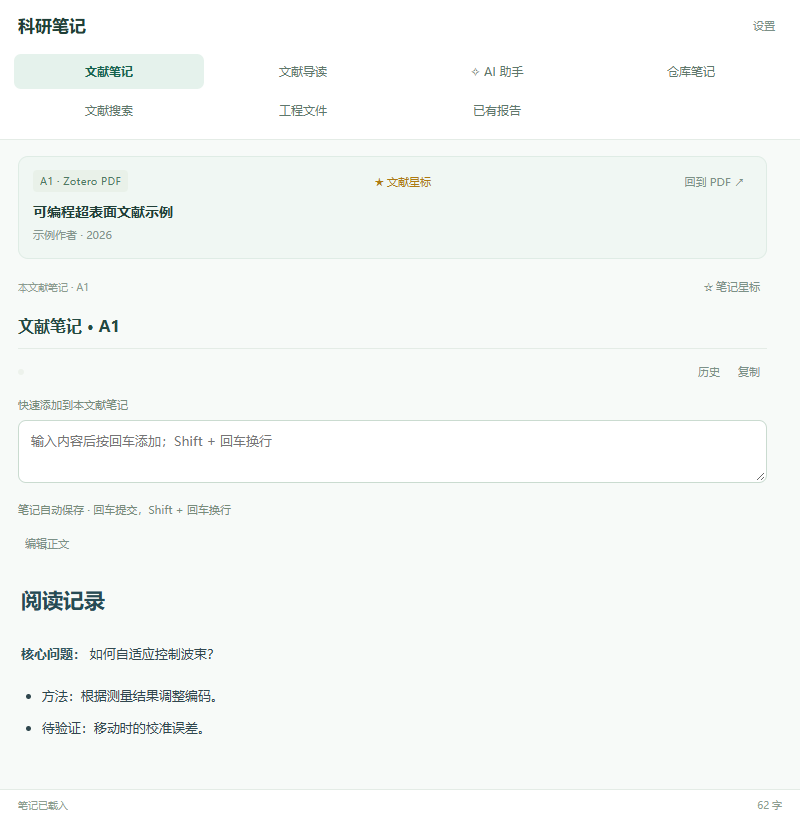
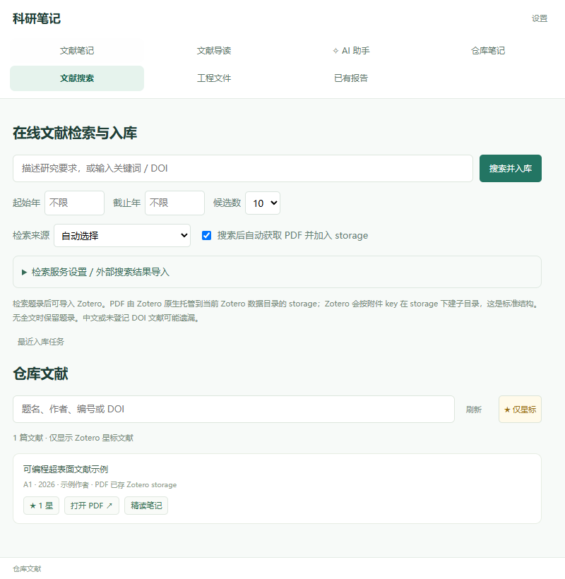

# 科研笔记仓库使用说明

在 Zotero 里阅读论文、写笔记、翻译、搜索文献并向 AI 提问。本文中的图片使用虚构示例，不含个人数据。

## 1. 安装与打开

需要 Windows、Python 3.12 和 Zotero 10.0.x。首次安装请按 [README 安装步骤](../README.md#安装)运行脚本，然后在 Zotero **工具 → 插件 → 齿轮 → 从文件安装插件**中选择脚本生成的 XPI。插件需要配套本地服务，不能只复制 XPI。

点击 Zotero 右下角 **科研仓库**，或按 **Ctrl + Alt + N**。打开 PDF 后，浮窗会关联当前论文；切换 PDF 后，文献笔记和助手会随之切换。拖动浮窗标题栏可移动，拖动边缘可调整大小。

## 2. 每个栏目做什么

| 栏目 | 作用 |
|---|---|
| 文献笔记 | 保存当前论文的个人阅读笔记 |
| 文献导读 | 查看论文的导读，与个人笔记分开 |
| AI 助手 | 围绕论文或仓库提问，也可操作笔记和工程文件 |
| 仓库笔记 | 新建、搜索和编辑独立笔记 |
| 文献搜索 | 在线找论文、导入 Zotero，以及筛选已收录文献 |
| 工程文件 | 管理文件、图片、文本和归档的 AI 对话 |
| 已有报告 | 查看独立调研报告，不混入笔记 |

## 3. 记录文献与标星

**文献笔记**默认按 Markdown 格式显示，内容会自动保存。在上方输入框写新内容，按 **Enter** 加入笔记；**Shift + Enter** 换行。修改已有正文时点 **编辑正文**，完成后再点一次。底部会显示保存状态；发生冲突时按提示对照，草稿会保留。

文献标题旁的 **☆ 文献星标**标记论文；笔记旁的 **☆ 笔记星标**只标记笔记，两者相互独立。笔记和报告也可通过星标置顶、筛选。

文献星标与 Zotero Style 的星级评级同步：未评级的文献加星后为 1 星，已有多星评级不会因加星而改变；**取消文献星标会清除该文献的评级**。在 Zotero 中修改评级后，组件会自动刷新。要在 Zotero 条目列表中看到评级星星，请安装并启用 Zotero Style 的评级列。

在 **文献搜索 → 仓库文献**点击 **只看星标**即可筛选；这里显示的是已关联到本仓库的 Zotero 文献，不是在线搜索的全部候选。

## 4. 翻译、总结和摘录

先在 **设置**中配置翻译服务。选中 PDF 文字后松开鼠标，译文会自动出现；译文可编辑、复制，浮窗可调整大小。点击 **总结**可概括原选文。

选中译文里的词句，点 **摘录到笔记**；右键该按钮可选择默认笔记、已有笔记或新建笔记。有当前 PDF 时默认保存到该论文的文献笔记。取消原文选区后浮窗关闭；在译文框中编辑或选词时保持打开。

## 5. 使用 AI 助手

打开 **AI 助手**，选择模型和推理等级，输入问题后发送，或按 **Ctrl + Enter**。在论文中提问时，助手使用 PDF 的文字层。可要求它解释方法、查找资料、新建或编辑笔记、管理文献标签、处理工程文本。

选中助手回答中的文字，点击 **摘录选文到笔记**，只追加选中的内容。对话可删除或撤销删除；较早的对话自动折叠，点击可展开；**归档到工程**会把对话存入工程目录。

DeepSeek 需要自行配置 API Key；ChatGPT 登录适配器为实验功能，账号和服务授权会影响可用性。提问、翻译或联网搜索时，相关内容会发送给所选服务；重要结论和页码请对照原文。

## 6. 搜索论文与保存 PDF

进入 **文献搜索**，输入研究要求、关键词、题名或 DOI。勾选 **搜索后自动获取 PDF 并加入 storage**可自动导入；取消勾选可先选候选再导入。结果和失败原因可在 **最近入库任务**查看。

Crossref 可直接使用；Elicit 需要自行配置有权限的 API Key。Undermind 当前需在网页搜索后，将 DOI 粘贴到外部结果导入框。全文获取受出版社和账号权限限制，失败时保留题录，不代表已获得 PDF。

PDF 由 Zotero 保存到其数据目录的 **storage**，子文件夹由 Zotero 管理。打开已关联文献时可跳转到对应 PDF。

## 7. 更新、备份与排错

- **更新：** Git 克隆安装的开源版在后台从停止状态启动时检查 GitHub；满足条件后同步源码并重建插件。运行中的后台不会强制重启；本地源码有改动或依赖变化时会暂停。ZIP 安装及旧版首次升级请按 README 手动更新。
- **备份：** 仓库导出不包含 Zotero 原 PDF、工程目录或密钥；迁移时分别备份 Zotero 数据目录和工程文件。
- **连接失败：** 先检查 Zotero 插件和本地服务是否启动。编辑草稿先保留，再重试。
- **翻译或 AI 不可用：** 检查服务配置、网络和账号权限；扫描版 PDF 需要先做 OCR。
- **没有星标按钮：** 确认文献已关联 Zotero 条目，等待星标同步或点击刷新。
