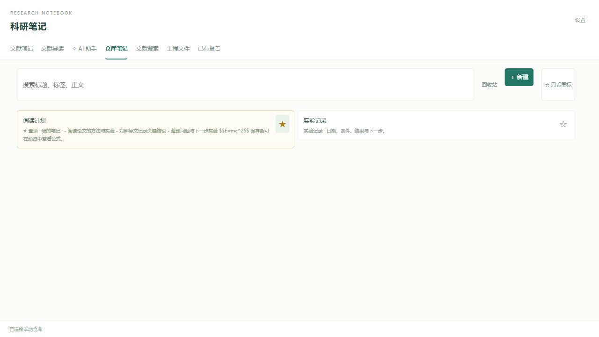
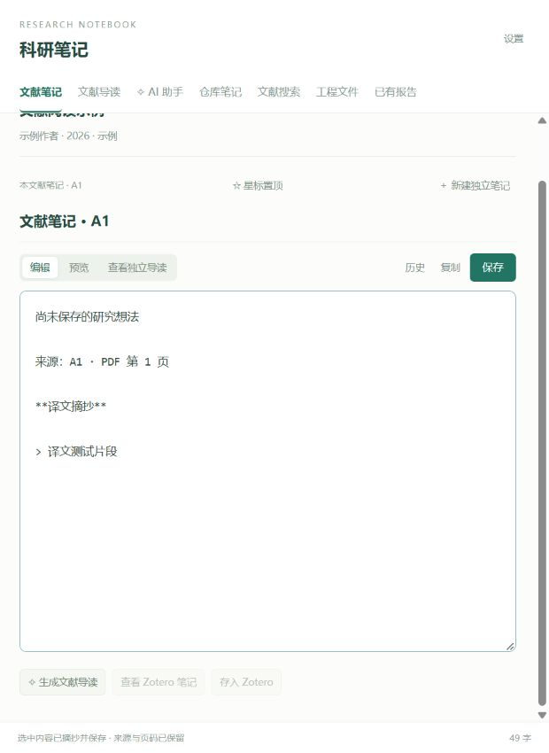
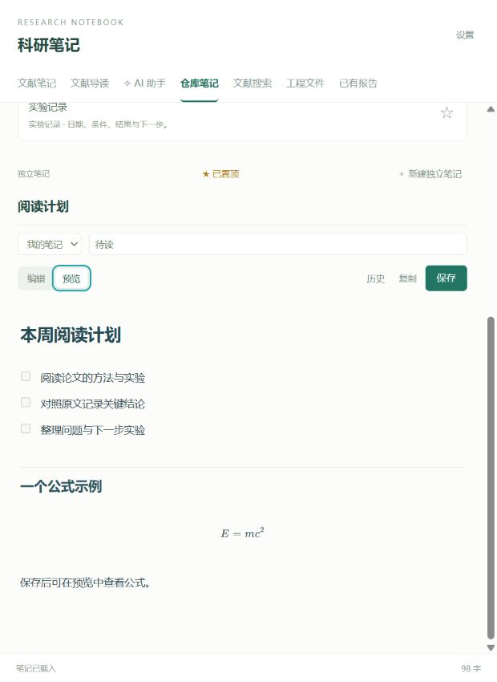
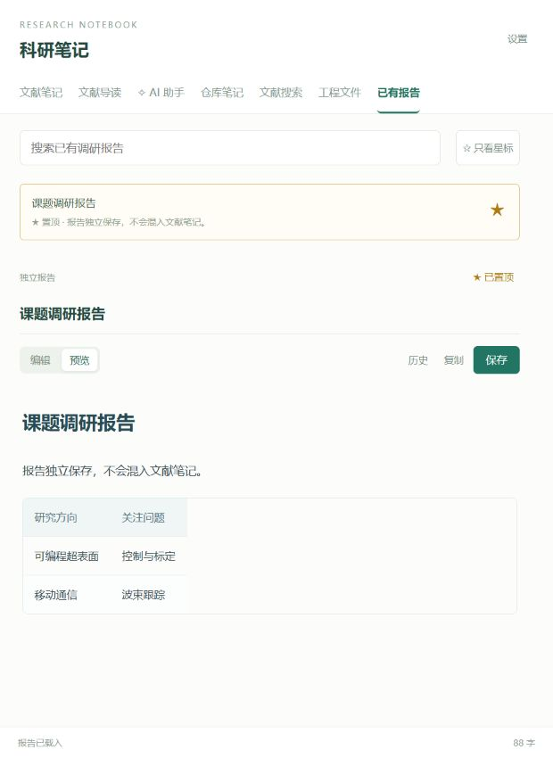
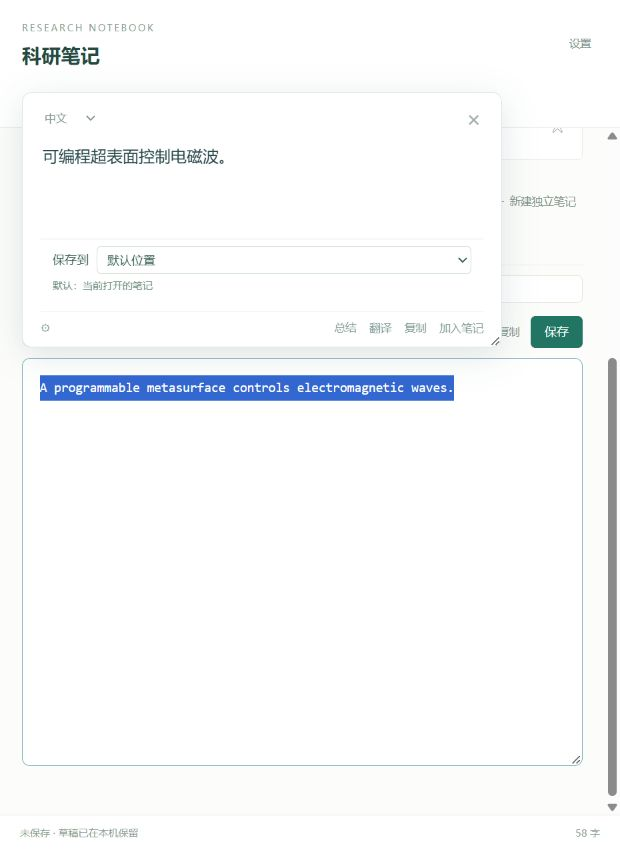
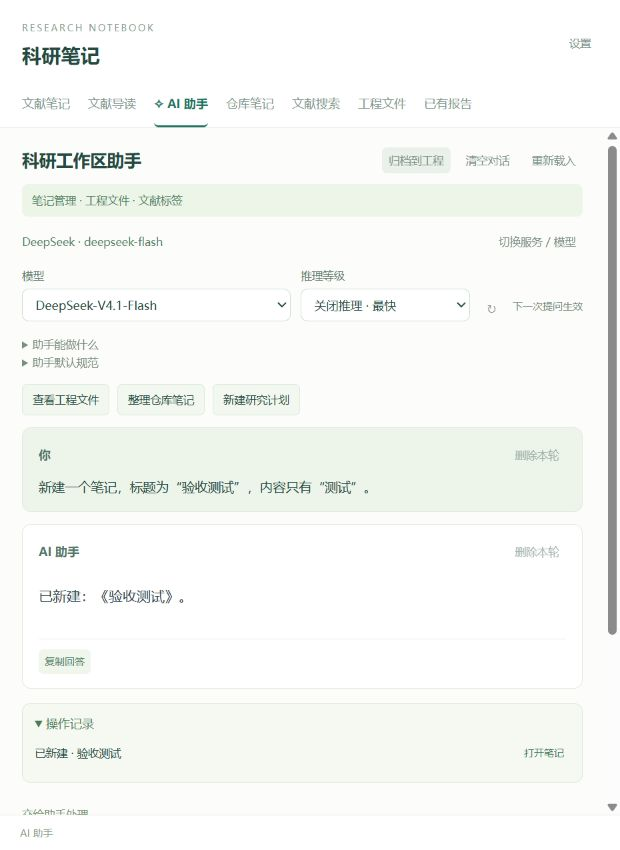
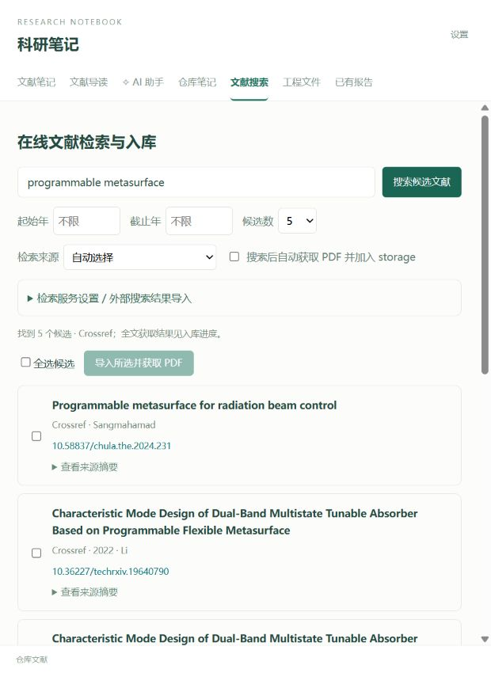
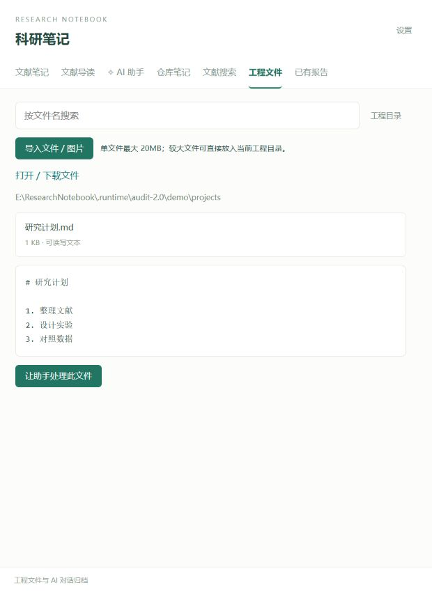

# 科研笔记仓库 2.0 使用说明

在 Zotero 中阅读 PDF、做笔记、翻译和提问。笔记、报告、工程文件各有独立位置。

## 1. 打开工作区

点击 Zotero **右下角「科研仓库」**；也可用 **Ctrl + Alt + N**。阅读 PDF 时点击「科研精读」，进入这篇论文的工作区。

标题栏可拖动，边缘和角落可缩放。关闭浮窗会保留编辑状态；位置异常时点 **↺** 重置。插件内打开关联 PDF 使用 Zotero 阅读器。

## 2. 内容放在哪里

| 入口 | 用途 |
|---|---|
| 文献笔记 | 当前论文自己的阅读笔记；默认摘录追加到这里 |
| 文献导读 | 阅读提示和 AI 精读，与自己的笔记分开 |
| 仓库笔记 | 查找、新建和编辑独立笔记，以及已有的论文笔记 |
| 已有报告 | 独立的调研报告；不混入笔记列表 |
| 工程文件 | 文件、图片、脚本、数据表及归档的 AI 对话 |
| 文献搜索 | 在线找论文、入库，以及查找已关联的 PDF |

## 3. 写笔记、置顶和恢复

点击 **＋ 新建** 创建笔记；点击卡片即可打开。编辑标题、分类、标签和正文后点 **保存**，或按 **Ctrl + S**。点 **预览** 查看 Markdown 和公式。

点 **☆** 添加星标，重要笔记或报告会排在前面；**只看星标** 可快速筛选。点 **历史** 对照旧版本。删除的笔记可从回收站恢复；外部修改发生冲突时，先对照最新正文再保存。

## 4. 划词翻译和总结

先在 **设置** 配置翻译服务。选中 PDF 文字、松开鼠标后自动翻译，无需再点翻译键。浮窗可调大小，译文可直接编辑、选词和复制；点 **总结** 概括原选文。

**保存到** 可选默认位置、已有笔记或新建笔记。有当前 PDF 时默认追加到这篇论文的阅读笔记；没有 PDF 时优先使用当前笔记，必要时创建并复用「我的摘录」。选中译文里的某个词或句子后保存，只摘抄这一段译文。

取消原选区、点击外部或按 **Esc** 会关闭译文。正在译文框里选词或编辑时，浮窗会保留，方便复制。Zotero PDF 翻译浮窗还提供 **AI 助手** 按钮，可带着原文或选中的译文继续提问。

翻译速度受网络和服务响应影响；相同选文会复用缓存。短句优先选快速模型、关闭推理。

## 5. 和 AI 助手一起工作

进入 **✧ AI 助手**，选择模型和推理等级，输入问题后发送，也可按 **Ctrl + Enter**。在论文工作区提问时会使用 PDF 文字层；没有论文时进入科研工作区助手。

可直接说：

- 「解释这篇论文的方法，并标注 PDF 页码。」
- 「新建笔记，标题为实验计划，内容为……」
- 「查找某篇笔记，把下面内容追加进去，保留原文。」
- 「删除这篇笔记。」删除后可恢复。
- 「读取工程文件研究计划.md，补充下一步安排。」
- 「给当前文献添加标签：待读、波束跟踪。」
- 「联网查找这个方法的相关工作，给出来源。」

助手的写入操作会显示操作记录。每轮对话可删除并撤销；长对话自动折叠较早部分，点击可展开。点 **归档到工程**，完整对话会存入工程目录的 `AI对话/`，不会新建成报告或笔记。

DeepSeek 需要自己的 API Key。ChatGPT 登录适配器为实验功能，可用模型取决于账号和服务授权；Plus 订阅不等于通用 API 额度。模型处理的内容会发送给当前选定的服务。AI 结论和页码仍需对照原 PDF。

## 6. 搜论文并加入 Zotero

在 **文献搜索** 输入题名、关键词或 DOI，按需要设置年份、候选数和来源。

勾选 **搜索后自动获取 PDF 并加入 storage**，搜索后自动开始入库；取消勾选，则先选择候选，再导入。可在 **最近入库任务** 查看成功、已有 PDF、题录已入库但全文缺失等结果。列表超过一批时点 **加载更多**。

- **Crossref** 无需 Key，适合题名、关键词和 DOI。
- **Elicit** 需要使用者自行配置有 API 权限的 Key；网页登录状态不会自动授予本插件 API 权限。
- **Undermind** 当前通过网页搜索后粘贴 DOI 结果导入，尚未实现本插件内的一键账号连接。

PDF 通过 Zotero 托管到实际数据目录的 **storage**，Zotero 会按附件编号建子目录；普通导入题录默认加入左侧的 **storage 分类**。重复 DOI 会优先复用已有条目与 PDF。

找不到原文时保留题录并显示原因，不把摘要或补充材料当成原文。可从出版社、机构权限或作者开放稿取得原文，再在精读页导入 PDF。付费墙、验证码和机构登录需要使用者处理，无法保证所有论文都自动下载。

## 7. 工程文件、图片与备份

在 **工程文件 → 工程目录** 选择具体项目文件夹；点 **导入文件 / 图片** 加入文件，常见图片可预览，文本可交给助手处理。单次导入上限 20MB，大文件可直接放入工程目录。修改过的工程文本保留历史，删除可恢复。

桌面工作台的 **导出仓库** 可备份笔记、报告、星标和编辑历史。它不包含 Zotero 原 PDF、工程目录或密钥；迁移时请分别备份 Zotero 数据目录和工程文件。

## 8. 常见问题

| 现象 | 处理 |
|---|---|
| 仓库打不开、出现连接错误 | 从桌面入口重新启动本地服务，再打开 Zotero 仓库；保留当前草稿 |
| 没有翻译结果 | 检查翻译服务、Key、网络和余额；先用短句测试 |
| PDF 无法问答或翻译 | 扫描件需要先 OCR；本插件不内置 OCR |
| 全文待获取 | 查看入库任务原因，取得原文后手动导入 |
| 窗口位置不正常 | 点标题栏 ↺ 重置布局 |
| 修改后没有保存 | 点保存或 Ctrl + S，检查底部是否显示成功或冲突 |
| 更新是否自动 | 当前支持本机配套应用发布新包后的自动更新；不是联网自行下载 GitHub 最新版 |

**开源安装：** Windows、Python 3.12、Zotero 10.0.x。先按项目 README 运行安装脚本，再安装它生成的 XPI。插件依赖配套本地服务，单独复制 XPI 不足以运行。截图来自隔离示例仓库；示例内容、个人笔记和 API 凭据均不随开源框架分发。
